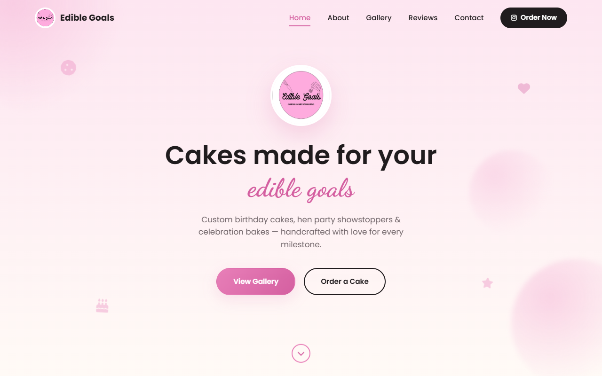
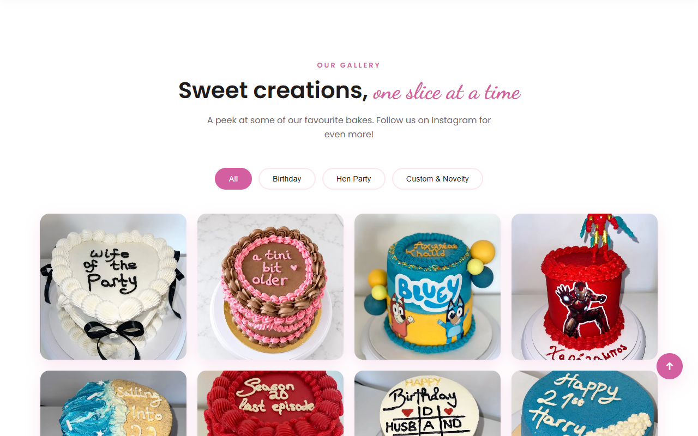
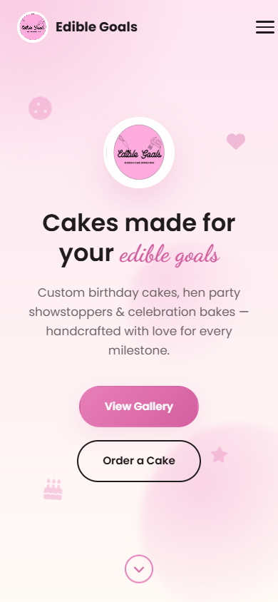

# Edible Goals: website for a custom cake business

A responsive one-page website for Edible Goals, a small business that bakes custom birthday, hen party and celebration cakes. Built with plain HTML, CSS and JavaScript, with no frameworks.

**Live site: https://andreaskarapanos98.github.io/edible-goals/**

## Screenshots

| Home | Gallery |
|:---:|:---:|
|  |  |

<p align="center"></p>

## Features

- **Responsive layout** for phones, tablets and desktops, with a mobile menu.
- **Active section highlighting** in the navigation bar while you scroll.
- **Scroll-reveal animations** using `IntersectionObserver`, so elements animate in as they appear on screen.
- **Filterable gallery** (Birthday, Hen Party, Custom & Novelty) with a **lightbox**: click a photo to enlarge it, and move between photos with the arrows or the keyboard (arrow keys and Esc).
- **Testimonial slider** that plays automatically and can be controlled with dots.
- **Contact form** that validates the fields and opens the visitor's email app with a pre-filled order enquiry (`mailto:`), so no server is needed.
- **Fast loading:** the 12 cake photos were converted from PNG to WebP, cutting the page's image weight from 11.6 MB to about 0.6 MB with no visible loss of quality.

## Tech

HTML5 · CSS3 (Flexbox, Grid, custom properties, animations) · vanilla JavaScript · Google Fonts · Font Awesome

## Run it locally

No build step is needed. Open `index.html` in a browser, or serve the folder:

```bash
npx serve .
```

## Project structure

```
index.html        Page markup: hero, about, gallery, reviews, contact
css/style.css     Styles, layout and animations
js/script.js      Menu, scroll effects, gallery filter and lightbox, slider, contact form
Photos/           Cake photos (WebP)
assets/           Logo and favicon
```

## Note

The contact email on the public version is a placeholder (`test@test.com`).
